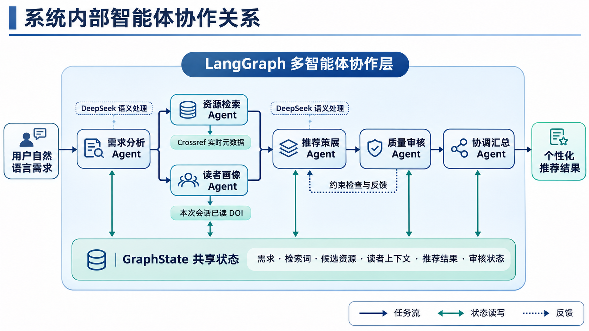
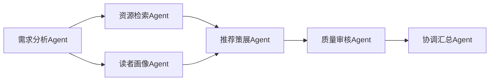

# LibMAS：智慧图书馆多智能体信息推荐原型

> 基于 LangGraph 的研究型原型，用于验证多智能体在图书馆信息推荐任务中的共享状态、并行协作、质量审核与运行可观察性。

LibMAS 面向用户的自然语言文献推荐需求，提供需求解析、学术资源检索、候选排序、约束审核和结果汇总的一体化协作流程。项目同时支持两种运行模式：**真实在线模式**调用 DeepSeek 处理语义任务、调用 Crossref 获取实时书目元数据；**离线演示模式**使用本地虚构样例，便于在没有外部 API 的情况下查看流程。

当前版本采用固定工作流，定位为可观察、可复现的研究原型和后续实验基线。它用于验证 LangGraph 是否适合承载该推荐任务，不代表完整的图书馆生产系统；目前没有接入真实馆藏和读者服务，也尚未实现根据需求或服务状态变化进行动态重规划。



## 协作流程



- 需求分析 Agent：识别主题、数量、语言、年份偏好、开放获取偏好和已读排除条件。
- 资源检索 Agent：扩展检索词；真实在线模式调用 Crossref Works API，离线模式查询本地目录。
- 读者画像 Agent：真实在线模式读取用户本次输入的已读 DOI；离线模式读取演示画像。
- 推荐策展 Agent：合并两个并行分支的结果，去除已读资源并排序。
- 质量审核 Agent：检查推荐数量、语言覆盖、已读排除和硬性年份条件。
- 协调汇总 Agent：输出推荐清单和协作轨迹。

检索和画像两个 Agent 在同一轮并行执行，之后由 LangGraph 等待两者完成，再把结果交给推荐 Agent。这体现了共享任务状态、角色分工、并行协作和结果汇总。

## 总体模块关系与数据流

```mermaid
flowchart LR
    U[用户/浏览器] -->|任务与运行配置| A[app.py：Streamlit表现层]
    A -->|make_llm / build_graph / task| M[main.py：业务逻辑与LangGraph编排]
    M -->|离线模式| D[(本地样例数据)]
    M -->|真实在线检索| X[Crossref REST API]
    M -->|真实在线语义任务| L[DeepSeek API]
    M -->|GraphState状态更新| M
    M -->|custom进度事件 + updates业务结果| A
    A -->|状态卡片、详情面板、轨迹、推荐答复| U
    C[命令行 main()] -->|共用 build_graph| M
```

- `main.py` 定义“做什么”：需求状态结构、Agent 节点职责、节点之间的依赖/并行关系、离线规则与可选 LLM 调用，以及命令行入口。
- `app.py` 定义“如何交互和呈现”：接收任务和模型配置、流式运行工作流、把节点事件映射为状态卡片和详情面板，并保存页面重绘所需的结果。
- `GraphState` 是 Agent 之间传递业务数据的共享状态；自定义 `custom` 事件是运行进度/快照通道；`updates` 是节点完成后的状态更新通道。网页将两者分别消费。
- 真实在线模式的候选资源来自 Crossref 书目元数据；Crossref 不提供全文保证，也不代表本校馆藏。DOI/来源链接供用户核验。
- `data/` 只为离线模式提供虚构样例。当前仍是固定拓扑基线，尚未接入本校真实馆藏、读者画像服务或动态微服务注册与流程重规划。

## 运行网页

需要 Python 3.10 或更新版本。项目目录中执行：

```bash
uv sync
uv run streamlit run app.py --server.address 127.0.0.1
```

网页侧栏可选择“真实在线（DeepSeek + Crossref）”或“离线演示（规则 + 本地样例）”。真实在线模式需要 DeepSeek 密钥；可在网页密码框临时输入，也可从 `.env` 读取。Crossref REST API 的公开 Works 检索不需要单独的 API Key。推荐将 `.env.example` 复制为 `.env` 并填写：

```dotenv
DEEPSEEK_API_KEY=你的密钥
DEEPSEEK_BASE_URL=https://api.deepseek.com
DEEPSEEK_MODEL=deepseek-flash
# 可选：Crossref polite pool 联系邮箱
CROSSREF_MAILTO=你的邮箱
```

密钥不会显示在页面结果或日志中，也不会写入 Agent 运行记录；调用模型时会作为认证信息发送到 DeepSeek 官方 API。命令显式绑定 `127.0.0.1`，让网页只在本机访问。模型默认使用 `deepseek-flash`，侧栏也可选 `deepseek-v4-pro`。DeepSeek API 的 OpenAI 兼容地址和可用模型以[官方文档](https://api-docs.deepseek.com/quick_start/pricing/)为准。Crossref 公开提供作品元数据检索，可通过 `mailto` 参数申请 polite pool，详见[Crossref REST API 文档](https://www.crossref.org/documentation/retrieve-metadata/rest-api/access-and-authentication/)。

页面用带 SVG 图标的 Agent 卡片实时显示“等待、运行中、已完成、需检查”状态和进度。点击卡片本身会从右侧滑出可收起的详情面板。运行期间面板跟随当前 Agent，展示实际输入状态、模型消息和节点结果；在线检索结果包含 DOI/来源链接。在线模式按用户在页面输入的已读 DOI 排除资源，不读取虚构读者画像。运行结束后也可点击卡片查看记录。记录中不包含 API Key，也不展示模型隐藏推理过程。

也可以从命令行运行。`live` 会实际请求 DeepSeek 和 Crossref；`demo` 使用离线样例：

```bash
uv run python main.py
uv run python main.py --task "推荐3篇英文的智慧图书馆信息推荐研究，优先开放获取，排除我已读的文献"
uv run python main.py --mode live --task "推荐5篇多智能体协同与智慧图书馆信息推荐研究，优先2022年及以后"
uv run python main.py --show-graph
```

离线模式用轻量规则和本地演示目录，适合查看流程和状态传递；需求理解效果不代表生产级水平。

## 项目边界

- `data/catalog.json` 和 `data/reader_profile.json` 中记录都是**虚构演示数据**，只在离线模式使用。
- 在线模式返回 Crossref 中的真实书目元数据，但其覆盖不等于本校馆藏，且 DOI 不保证全文开放；建议通过来源链接核对出版信息。
- 这是固定拓扑的协作基线，尚未实现需求变化触发的动态重规划，也未接入真实图书馆馆藏/读者服务微服务。
- 论文后续可以在此基础上增加：需求状态版本、服务能力注册表、基于需求增量的Agent选择、质量反馈后的局部重规划，以及固定流程/单Agent/多Agent的对照实验。

## 文件

- `main.py`：共享状态、Agent节点、并行分支、合并、审核与CLI入口。
- `app.py`：Streamlit网页，呈现可点击 Agent 卡片、右侧详情面板、协作过程和可导出的节点运行记录。
- `crossref_api.py`：Crossref Works API 适配器，负责在线书目检索及字段归一化。
- `data/catalog.json`：虚构的本地资源目录。
- `data/reader_profile.json`：虚构的读者兴趣与已读记录。
- `pyproject.toml`：LangGraph基础依赖及可选LLM依赖。

LangGraph 的 Graph API 以共享 State、节点和边表达工作流；本 Demo 使用自定义流事件和节点更新展示运行状态，做法参照[官方 Streaming 文档](https://docs.langchain.com/oss/python/langgraph/streaming)。
